# Jatri (যাত্রী) — Air, Bus & Train Tickets

One Android app to search, compare, book and pay for **flight, bus and train tickets in Bangladesh**.
"Jatri" is a working name.

> **Status: Phase 7 (My Trips, cancellation & refunds, notifications) is done.** Built so far:
> - Phase 1: foundation and the v2 "soft neutral" style.
> - Phase 2: phone OTP login and the FastAPI backend.
> - Phase 3: bus search, seat map and booking hold.
> - Phase 4: payment gateway sandbox, verified callbacks, e-ticket with QR and PDF.
> - Phase 5: flight search (one way, round trip, multi-city), filters, fare rules, passengers, PNR hold, e-tickets.
> - Phase 6: train search with classes and off days, coach & seat selection, NID-checked passengers, hold, pay, e-ticket.
> - Phase 7: My Trips (offline), ticket timeline, cancellation with refund preview, refunds, notifications, reminders.

| Bangla · light | English · light | Bangla · dark |
|---|---|---|
|  |  |  |
| 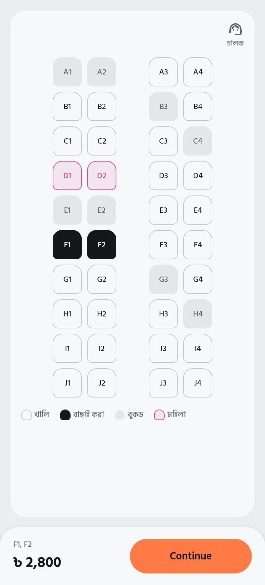 | 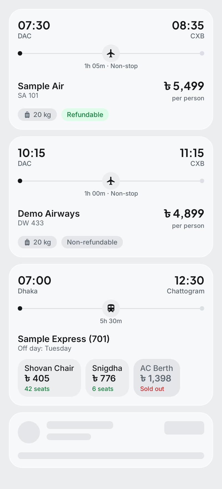 |  |

All 45 screenshots are in [`docs/screenshots/phase1`](docs/screenshots/phase1). They are rendered on the
JVM by Roborazzi, not on a phone.

## Download the app

Each finished phase is published on the **[Releases page](../../releases)** with a debug APK.
Open the page on your phone, download the APK, and install it (allow "install unknown apps").
Every push and pull request also builds an APK, found under **Actions → the run → Artifacts**.

## Repository layout

```
Jatri-App/
├── android/                 # Kotlin + Jetpack Compose app
│   ├── app/                 # MainActivity, splash, NavHost, bottom navigation, launcher icon
│   ├── build-logic/         # Gradle convention plugins (jatri.android.library, .feature, .hilt …)
│   ├── core/
│   │   ├── model/           # Pure-Kotlin domain types (Location, SearchQuery, Money in paisa …)
│   │   ├── common/          # BDT/Bangla-digit/date formatters, dispatchers, network monitor
│   │   ├── designsystem/    # Theme (colours, type, shapes, spacing), fonts, generic components
│   │   ├── ui/              # Travel UI: mode tabs, search card, pickers, result cards, seat map
│   │   ├── network/         # Retrofit/OkHttp/Kotlinx Serialization setup, API envelope
│   │   ├── database/        # Room (recent searches; tickets & travellers later)
│   │   ├── datastore/       # Settings: language, theme, onboarding
│   │   └── data/            # Repositories + seed locations + clearly-marked mock content
│   └── feature/             # auth, home, flight, bus, train, booking, payment,
│                            # trips, offers, account, notifications
├── backend/                 # FastAPI + PostgreSQL: auth, profile, locations (see backend/README.md)
├── design/                  # tokens.json, app icon SVG/PNG sources, font licences
├── .github/workflows/        # CI: Android build + tests, backend tests, release on phase-* tags
├── docs/openapi.json        # API spec exported from the backend
└── docs/screenshots/
```

## Requirements

- **Android Studio** (a version that supports AGP 9.5) or the command line with **JDK 17+**
- Android SDK **platform 37.1** and **build-tools 37** (Android Studio installs them when you sync)
- Min SDK 24 (Android 7.0), target SDK 37

Toolchain: Gradle 9.9 · AGP 9.5 · Kotlin 2.4 · Compose BOM 2026.11 · Hilt 2.60 · Room 2.8 · Navigation 2.10.

## Run it

Open the `android/` folder in Android Studio and press **Run**, or:

```bash
cd android
./gradlew :app:assembleDebug          # debug APK → app/build/outputs/apk/debug/
./gradlew testDebugUnitTest           # unit tests + screenshot tests
./gradlew :app:recordRoborazziDebug   # re-render screenshots → app/build/outputs/roborazzi/
./gradlew :app:lintDebug              # lint for all modules (missing translations are errors)
./gradlew :app:assembleRelease        # R8-minified release APK (about 3.6 MB, unsigned)
```

The first launch shows onboarding (choose Bangla or English), then Home. Walk through it: pick
cities, then Search, a result, a seat or class, passenger details, Review & pay, and the success
screen. Every step in that flow can be reached.

## Phase 7 — My Trips, cancellation & refunds, notifications

| My Trips (offline) | Cancel & refund | Refunded ticket | Notifications |
|---|---|---|---|
| 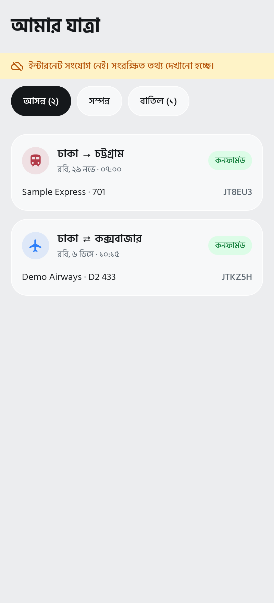 | 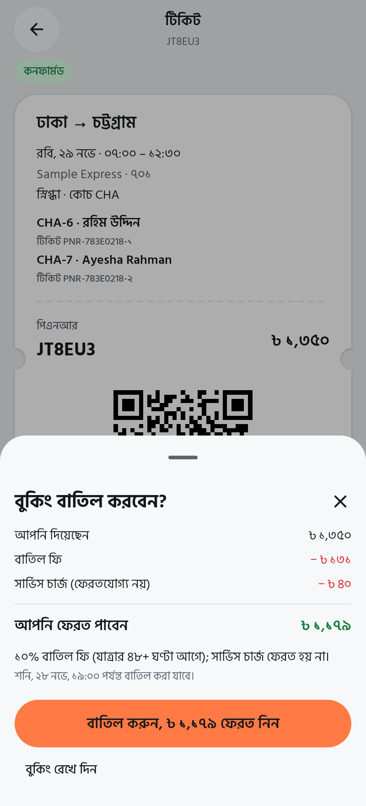 | 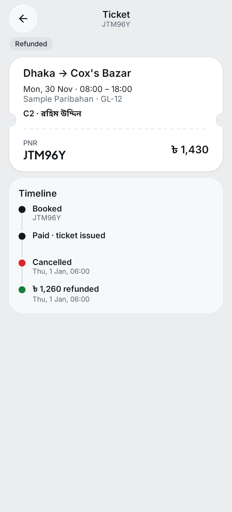 | 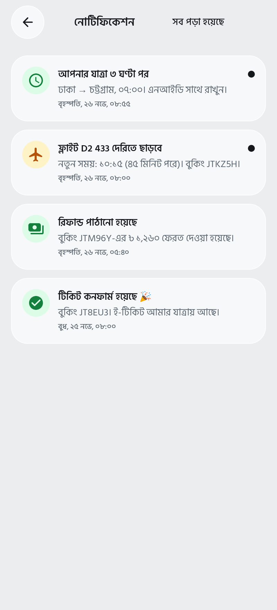 |

- **My Trips**: Upcoming / Completed / Cancelled from the server. The list and every ticket (with its
  QR code) are **saved on the phone**, so they open without internet; an offline banner says so.
  Cleared on logout.
- **Ticket detail**: QR, PNR, passengers and ticket numbers, a **timeline** (booked → paid → journey,
  or → cancelled → refund on its way → refunded), PDF/share, and **add to calendar**.
- **Cancellation with a refund preview** (`GET /bookings/{id}/cancel-quote`): what you paid, the
  cancellation fee, the non-refundable service charge, what comes back, the reason and the deadline.
  The app sends the quoted amount back with the cancel; if it moved, the server says `refund_changed`
  and the app shows the new quote.
  - Bus: 24 h+ before → 10% fee, 12–24 h → 50%, under 12 h → no cancellation.
  - Train: 48 h+ → 10%, 24–48 h → 25%, 12–24 h → 50%, under 12 h → no cancellation.
  - Flight: the fare rules (refund fee per passenger; non-refundable fares give nothing back; closed
    inside the fare's deadline).
- **Refunds**: a background job sends them to the gateway (mock: instant; SSLCommerz refund API and
  status follow-up), retries, and raises an alert after 5 failures. Paid bookings the provider
  refused are refunded in full.
- **Notifications**: inbox (`GET /notifications`, mark read / all read), unread dot on the Home bell.
  Messages: ticket confirmed (plus SMS and e-mail with the PDF), payment failed, ticket not issued,
  cancelled, refund sent, journey reminders, flight delays. Bangla messages use Bangla digits but
  keep codes as printed (JTM96Y, D2).
- **Push**: FCM HTTP v1 on the server (`POST /devices` registers a phone). **Reminders 24 h and 3 h
  before departure** are also scheduled on the phone (AlarmManager), so they arrive without push or
  internet; tapping one opens the ticket.
- **Flight changes**: a job asks the airline about each upcoming flight; a delay moves the times on
  the ticket and tells the traveller.

## Phase 6 — trains

| Results | Coach & seats | Passengers (NID) | E-ticket |
|---|---|---|---|
| 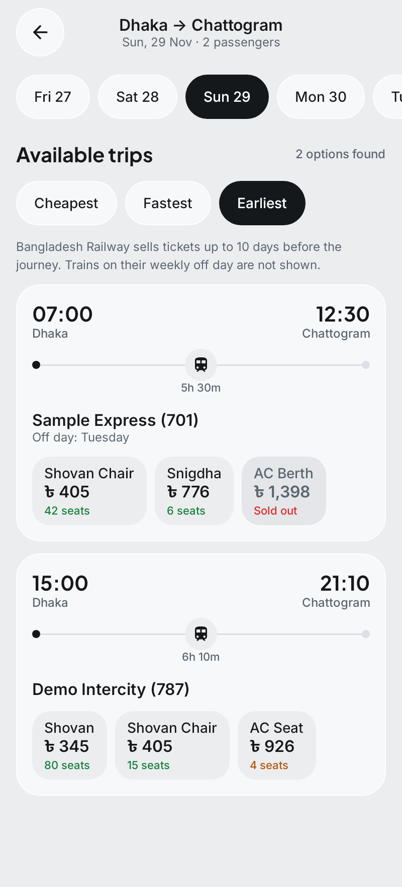 | 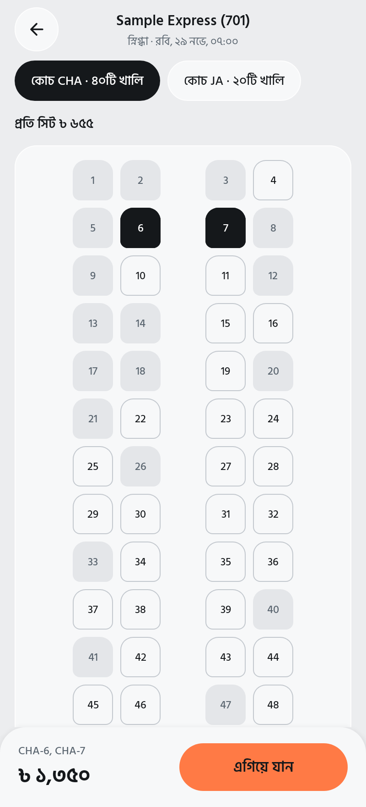 | 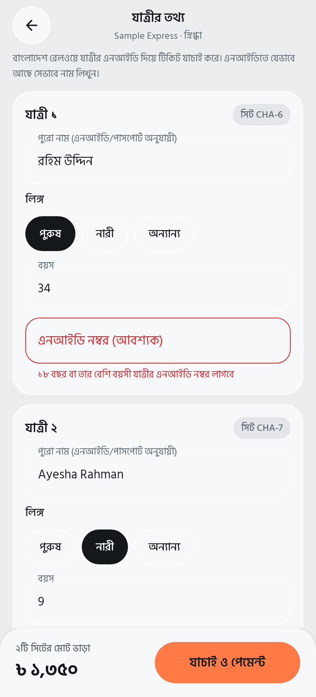 | 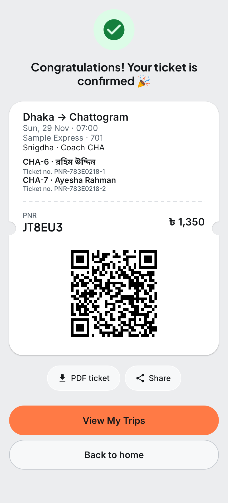 |

- **TrainProvider adapter** (`search`, `get_details`, `get_coaches`, `hold`, `confirm`, `cancel`, `get_status`)
  with a **mock provider**. Bangladesh Railway tickets can only be sold through the railway or an
  authorised partner, so the real adapter is plugged in once such an API is available.
- **Railway rules**:
  - Sales open **10 days** before the journey (`outside_sale_window` otherwise; the app limits the dates too).
  - Each train can have a **weekly off day**; it is shown on the card and the train is left out on that day.
  - Classes: Shovan, Shovan Chair, Snigdha, AC Seat, F Seat, F Berth, AC Berth, priced by the
    railway's per-km class ratios (placeholder trains like "Sample Express").
  - Every passenger aged **18+ needs an NID**; under 18 may give a birth registration number.
- **Results**: train name and number, times, duration, off day, and every class with its fare and
  seats left (sold out greyed). Tapping a class opens its coaches.
- **Coach & seat**: coach pills (CHA, JA, KA… with free seats), a 2+2 seat map per coach, up to 4
  seats across coaches; seats someone else is paying for show as taken.
- **Booking**: `POST /bookings` with `mode: "train"` re-checks the fare (`price_changed`), locks the
  seats in Redis and holds them with the provider for 10 minutes; then the same payment flow issues
  the ticket and a PDF with train, class and coach.
- Endpoints: `POST /trains/search`, `GET /trains/{trip_id}/seats?travel_class=`.

## Phase 5 — flights

| Search (round trip) | Results + filters | Fare details | Passengers | E-ticket |
|---|---|---|---|---|
| 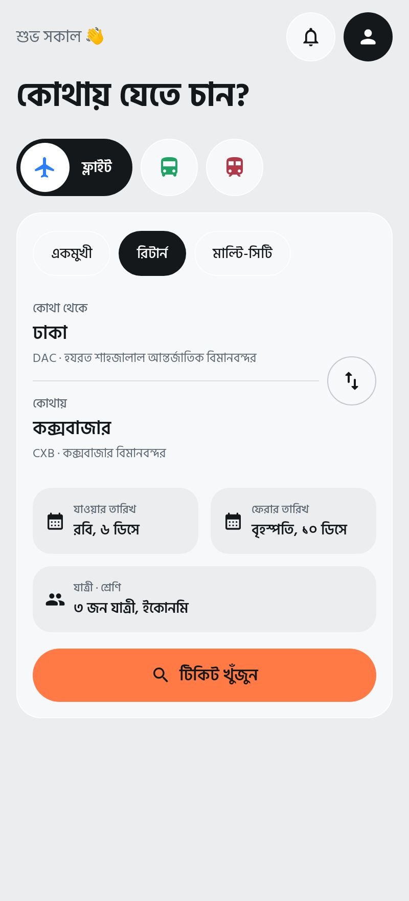 | 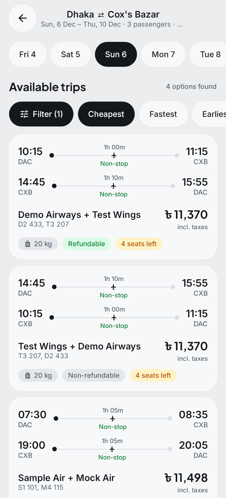 | 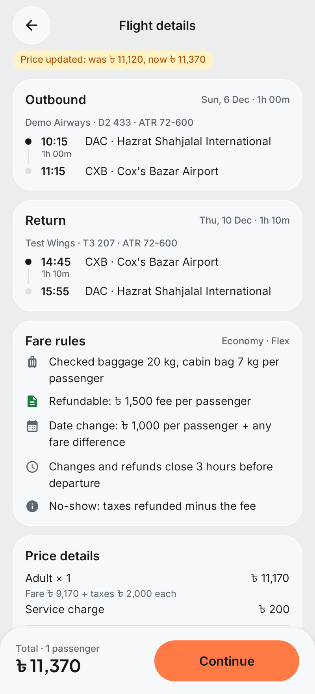 | 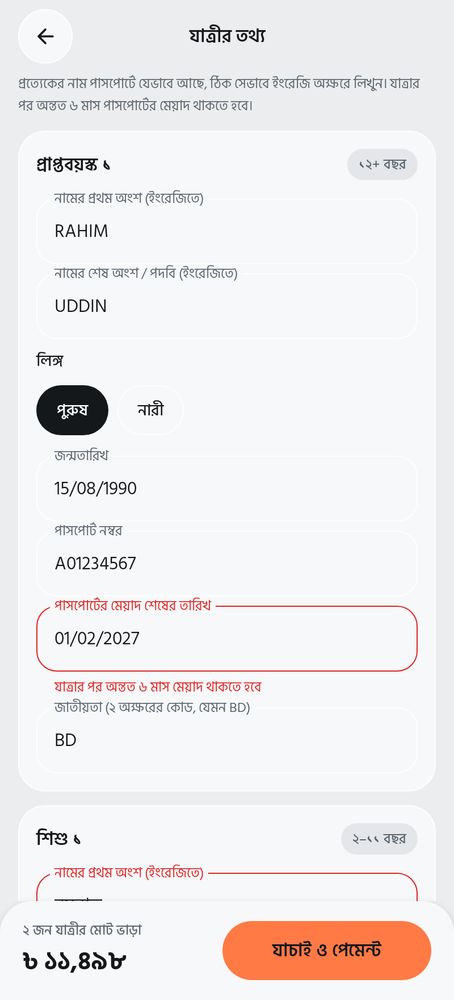 | 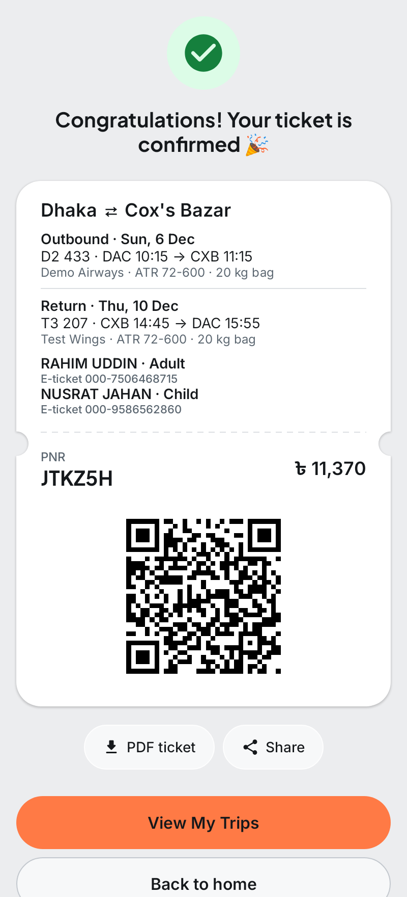 |

- **FlightProvider adapter** (`search`, `get_details`, `hold`, `confirm`, `cancel`, `get_status`) with a
  deterministic **mock provider** (placeholder airlines "Sample Air", "Demo Airways"...). A Duffel
  adapter can replace it later without touching the rest.
- **Search**: one way, round trip and multi-city (up to 4 flights); adults, children and infants
  (infants ≤ adults, at most 9 with a seat); Economy, Premium Economy, Business.
  - Regional airports connect through Dhaka; long international routes also get one-stop options.
  - Times are shown in **each airport's local time** (as on a boarding pass); durations are real.
- **Results**: airline, flight numbers, times with "+1", duration, stops, baggage, refundable tag,
  seats left and the total price. **Filters**: max price, airline, stops, departure time, refundable
  only. **Sort**: cheapest, fastest, earliest. Date pills move the whole trip (a round trip keeps its length).
- **Fare details**: every leg with aircraft and layovers, the **fare rules in plain words** (refund
  fee, date change fee, deadline, no-show, baggage) and the price per passenger type. The price is
  checked live; if it changed since the list, the screen says so.
- **Passengers**: given name + surname in English letters (as on the passport/NID), gender, date of
  birth (age must fit adult 12+ / child 2–11 / infant under 2 on the travel dates); **international
  trips need a passport valid 6 months after the trip**. The server checks all of it again.
- **Booking**: `POST /bookings` with `mode: "flight"` re-prices the offer (`price_changed`), holds it
  with the airline (PNR) for 10 minutes, then the same payment flow as buses issues **13-digit e-ticket
  numbers** and a flight PDF ticket (local times, baggage, cabin, PNR).
- Endpoints: `POST /flights/search` (cached), `GET /flights/{offer_id}` (live). Migration `0004`.

## Phase 4 — payments & e-tickets

- **PaymentGateway adapter** with two implementations:
  - **SSLCommerz** (bKash, Nagad, Rocket, cards; sandbox first). The IPN callback is confirmed with
    SSLCommerz's Order Validation API before anything is trusted.
  - A **mock gateway** that hosts its own checkout page, for testing without credentials. Production
    refuses to start with it.
- **Flow**:
  1. "Pay" opens the gateway in a Chrome Custom Tab.
  2. The gateway calls the server directly (server to server).
  3. The server checks the signature and the amount, confirms with the bus provider, and issues the
     ticket: `ticketed`.
  4. The browser returns to the app via `jatri://payment/return`, and the app shows the e-ticket.
  - The app's own "success" is never trusted. Replayed or forged callbacks change nothing.
- **Failure handling**:
  - A failed payment leaves the seats held, so the user can try again.
  - A wrong amount is rejected.
  - If the operator refuses after the money is taken, the booking is marked `failed` and the payment
    `refund_pending`, with an alert in the logs.
- **E-ticket**:
  - The QR is signed (HMAC), so it can't be forged.
  - The A5 **PDF is in Bangla + English** (HarfBuzz shaping, [sample](docs/screenshots/phase4/ticket_pdf_sample.png)).
  - The app downloads the PDF once and keeps it offline; it can be opened or shared.
- **Background worker** (ARQ): releases unpaid holds every minute.
- **Demo APK**: the in-app demo gateway shows a "Pay / Fail" sheet, so the whole flow works on a phone
  without a server. Only the PDF needs the real backend.

## Phase 3 — bus booking

- **Provider adapter pattern** on the backend: a `BusProvider` interface (`search`, `get_details`,
  `get_seats`, `hold`, `confirm`, `cancel`, `get_status`) with a **mock provider** behind it. An authorised
  bus aggregator or operator API plugs in later without touching the app.
- **Search** (`POST /buses/search`) is cached in Redis for 5 minutes. The **seat map** (`GET /buses/{id}/seats`)
  shows seats other people are holding right now.
- **Booking hold** (`POST /bookings`):
  - The live trip, price and seats are re-checked first. A different price returns `price_changed`.
  - Ladies seats can only be booked for women.
  - Seats are locked in Redis all-or-nothing, so two people can never hold the same seat.
  - The hold lasts 10 minutes and then expires on its own.
  - An `Idempotency-Key` header stops double holds when a request is retried.
  - Only the owner can see a booking.
  - NID is encrypted at rest and shown masked (`••••••7890`).
- **App flow**:
  1. Results with date pills and retry on error.
  2. Seat map with boarding and dropping points.
  3. Passenger form (name, gender, age, optional NID, contact). The first name is pre-filled from the profile.
  4. Review & pay shows the real booking, price breakdown and the server's countdown.
  5. When the hold expires, a dialog sends the user back to choose seats.
- **Tests**: 31 backend tests (on SQLite + memory store and on PostgreSQL + Redis). Android tests now
  include a **contract test** that runs real backend responses through the app's mappers.

## Phase 2 — login & accounts

- **Backend** (`backend/`): FastAPI, async SQLAlchemy, PostgreSQL, Alembic migrations, seed
  locations, Docker. It has 17 tests and passes on both SQLite and PostgreSQL. See [backend/README.md](backend/README.md).
- **Login**: phone number → 6-digit OTP → name (new users only). Errors come from the server in
  Bangla and English. The SMS Retriever API fills the code in automatically, with no SMS permission.
- **Tokens**: a 15-minute access token and a 30-day refresh token. Both are stored in one blob encrypted
  with AES-256-GCM, using an Android Keystore key that can't be exported. On a 401 the app refreshes
  once and retries. If the refresh fails, the user is logged out.
- **Account**: profile card, edit name and email, log out (works offline), and delete account
  (Google Play requirement).
- **Booking needs login**: guests can search freely. "Continue" to the passenger form asks
  them to log in, then carries on.
- **Locations** come from `GET /locations`, with the bundled list as the offline fallback.

### Mock backend vs real backend

The APK works on any phone **without a server**: by default it uses a built-in mock backend that
follows the same rules (the OTP is always **123456**). To use the real API:

```bash
cd android
./gradlew :app:assembleDebug -Pjatri.useMockApi=false -Pjatri.apiBaseUrl=http://10.0.2.2:8000/api/v1/
```

`10.0.2.2` is your computer as seen from the Android emulator. Debug builds allow plain HTTP only
to `10.0.2.2` and `localhost`. Release builds are HTTPS-only.

## Phase 1 — what's built

- **Design system**: Material 3 light/dark colour schemes (dynamic colour off), bundled fonts
  (Hind Siliguri, Inter, Plus Jakarta Sans — all OFL), a 4 dp spacing grid, pill buttons and chips,
  and 24 dp cards. See [Visual style](#visual-style-v2).
- **Components**: CTA/primary/outlined/small buttons, `PillChip`, `CircleIconButton`, card, status & tag chips, empty/error/loading states,
  shimmer skeletons, offline banner, `TicketShape` + `TicketCard`, `PriceSummaryBar`,
  `PassengerCounter`, top bar, text field, bottom sheet, `SearchCard`, `TravelModeTabs`,
  `CityPickerSheet`, `DatePickerSheet`, `PassengerClassSheet`, flight/bus/train `ResultCard`s, and `SeatMap`.
- **Navigation**: type-safe Navigation Compose routes for all 25 screens. A floating pill bottom bar
  has Home · My Trips · Offers · Account.
- **Language**: everything is in `strings.xml` (`values` = English, `values-bn` = Bangla). Bangla is
  the default. Language can be switched in onboarding and in Account, using the per-app locale API.
  Bangla digits appear in prices, dates and counts.
- **Money** is stored as whole paisa (`Money(paisa: Long)`) and formatted with lakh grouping:
  `৳ 1,25,000` / `৳ ১,২৫,০০০`.
- **App icon**: an adaptive icon plus a monochrome version (Android 13+ themed icons), and the Android 12+ splash screen.
- **Local data**: recent searches saved in Room, settings in DataStore.
- **Tests**: formatters, phone validation, seed data, seat-selection rules (max 4, booked seats
  blocked), and 36 screenshot tests (Bangla light, English light, Bangla dark).

## What is mocked

| Area | Phase 1 behaviour | Becomes real in |
|---|---|---|
| SMS gateway | Backend prints the OTP to its log; the APK's mock backend uses 123456 | Before release |
| Bus trips & seats | Real API flow, **mock bus provider** with placeholder operators ("Sample Paribahan") | When an authorised bus API is connected |
| Payment gateway | Mock gateway by default; SSLCommerz adapter needs a sandbox store id/password | When you create the SSLCommerz sandbox account |
| PDF in the demo APK | The demo backend has no PDF renderer (QR ticket works) | Works with the real backend |
| Flights | Real API flow, **mock flight provider** with placeholder airlines ("Sample Air") and approximate prices | When a Duffel (or other) sandbox key is added |
| Trains | Real API flow, **mock train provider** with placeholder trains and approximate fares | When an authorised railway ticketing partner API is available |
| Push messages on the phone | The server sends FCM pushes when `JATRI_PUSH_PROVIDER=fcm`; the app doesn't include Firebase yet, so it has no token to register (reminders still work, scheduled on the phone) | When a Firebase project (`google-services.json`) is added |
| E-mail with the PDF | Logged by the server unless SMTP is configured | When SMTP settings are added |
| Refunds | Mock gateway refunds at once; SSLCommerz refund API is ready | With the SSLCommerz sandbox |
| Offers, popular routes | Sample promo codes | Phase 8 |
| Hotline number | Placeholder `+8809600000000` in `HelpScreen` | Before release |

Every placeholder screen shows a "Coming in Phase N" banner, so sample data can't be mistaken for
real data.

## Visual style (v2)

Soft neutral look: a grey canvas, lighter cards with a hairline light edge, very round shapes and
big bold left-aligned headlines.

- **Black "pills" mark what is selected**: mode, date, sort option, tab, class, language. In dark
  mode the pills are white.
- **Orange is only for the main money/search actions** ("Search Tickets", "Pay", "Continue"), so they
  always stand out. Teal stays as the brand colour (icon, splash).
- **Gradient artwork instead of photos**: each mode's colour with a dashed route arc and a big
  white icon (`ModeIllustration`). Real operator photos can replace it later.
- **Floating pill bottom navigation**: the active tab shows icon + label, the others show icons
  only (their labels are still read by screen readers).
- **Result cards**: times on both sides, a line with the mode icon in the middle, the operator and
  price below. Results have a strip of date pills (±2 days) that reloads the list.
- **Fonts**: Plus Jakarta Sans for English headlines, Inter for English text, Hind Siliguri (bold
  for headlines) for Bangla.

## Design decisions worth knowing

- **Dark text on orange buttons.** White on `#FF7A45` is only 2.6:1 contrast and fails WCAG AA.
  Ink on orange is 6.5:1. Black pills with white text are about 18:1.
- **Warning and success text** use darker shades on light cards for the same reason.
- **Seat codes (A1, B2) stay in Latin letters and ASCII digits** in both languages, because they are
  printed on the bus that way.
- **System bar icons follow the app theme** (dark icons on the light canvas, light icons in dark mode).
- **No backups**: `allowBackup=false` and data-extraction rules exclude everything, so tokens and
  tickets never leave the device.

---

## সংক্ষেপে (বাংলা)

**যাত্রী** একটি অ্যান্ড্রয়েড অ্যাপ। এতে বাংলাদেশের ফ্লাইট, বাস ও ট্রেনের টিকিট এক জায়গায় খোঁজা, তুলনা করা, বুক করা ও পেমেন্ট করা যাবে।

**এখনকার অবস্থা: Phase 1 (ভিত্তি) সম্পন্ন, নতুন "নরম ধূসর" ডিজাইনসহ।** বাছাই করা জিনিস কালো pill-এ, মূল বাটন কমলা, ছবির জায়গায় gradient ইলাস্ট্রেশন, আর নিচে ভেসে থাকা pill navigation।
- প্রজেক্টের কাঠামো আর মডিউলগুলো তৈরি হয়েছে।
- ডিজাইন সিস্টেম তৈরি: কালার, ফন্ট (হিন্দ শিলিগুড়ি ও ইন্টার) আর কম্পোনেন্ট।
- সব স্ক্রিনে navigation দিয়ে যাওয়া যায়।
- বাংলা ও ইংরেজি দুই ভাষাই আছে। বাংলা ডিফল্ট, আর বাংলায় সংখ্যাও বাংলায় দেখায়।
- লাইট ও ডার্ক থিম আছে।
- অ্যাপ আইকন আর স্প্ল্যাশ স্ক্রিন তৈরি।

সার্চের ফলাফল, সিট ম্যাপ, পেমেন্ট আর আমার যাত্রা এখন **নমুনা তথ্য** দেখায়। প্রতিটি স্ক্রিনে "Phase N-এ আসছে" লেখা থাকে।

**চালানোর নিয়ম:** Android Studio-তে `android/` ফোল্ডার খুলে Run চাপুন। অথবা কমান্ড লাইনে `cd android && ./gradlew :app:assembleDebug` চালান।

**Phase 2 সম্পন্ন:**
- ফোন নম্বর ও OTP দিয়ে লগইন।
- এনক্রিপ্ট করা টোকেন, মেয়াদ শেষ হলে নিজে থেকে রিফ্রেশ।
- প্রোফাইল সম্পাদনা, লগআউট আর অ্যাকাউন্ট মুছে ফেলার সুবিধা।
- FastAPI + PostgreSQL ব্যাকএন্ড।

সার্ভার ছাড়াও APK ফোনে চলে। ডেমো মোডে OTP সবসময় **123456**।

**Phase 3 সম্পন্ন:**
- বাস সার্চ।
- সিট ম্যাপ, সাথে ওঠার ও নামার স্থান।
- যাত্রীর ফর্ম।
- ১০ মিনিটের আসল সিট হোল্ড। একই সিট দুজন একসাথে ধরে রাখতে পারবে না।

বাস কোম্পানির ডেটা এখনো নমুনা (mock provider)।

**Phase 4 সম্পন্ন:**
- পেমেন্ট গেটওয়ে স্যান্ডবক্স: SSLCommerz-এর মাধ্যমে বিকাশ, নগদ, রকেট আর কার্ড, সাথে একটা ডেমো গেটওয়ে।
- সার্ভার নিজে পেমেন্ট যাচাই করে।
- স্বাক্ষর করা QR সহ ই-টিকিট।
- বাংলা PDF টিকিট।

**Phase 5 সম্পন্ন:**
- ফ্লাইট সার্চ: একমুখী, রিটার্ন আর মাল্টি-সিটি (সর্বোচ্চ ৪টি ফ্লাইট)।
- ফলাফলে ফিল্টার (দাম, এয়ারলাইন, বিরতি, ছাড়ার সময়, রিফান্ডযোগ্য) আর সাজানো।
- ভাড়ার নিয়ম সহজ ভাষায়: রিফান্ড, তারিখ পরিবর্তন, ব্যাগেজ।
- যাত্রীর তথ্য: পাসপোর্টের মতো ইংরেজি নাম, জন্মতারিখ, আন্তর্জাতিক যাত্রায় পাসপোর্ট (যাত্রার পর ৬ মাস মেয়াদ)।
- এয়ারলাইনের কাছে ১০ মিনিটের হোল্ড (PNR), পেমেন্ট, তারপর ই-টিকিট নম্বর আর PDF।
- প্রতিটি বিমানবন্দরের স্থানীয় সময় দেখায়।

এয়ারলাইনের ডেটা এখনো নমুনা (mock provider)। Duffel-এর key দিলে আসল স্যান্ডবক্স যুক্ত হবে।

**Phase 6 সম্পন্ন:**
- ট্রেন সার্চ: প্রতিটি শ্রেণির (শোভন, শোভন চেয়ার, স্নিগ্ধা, এসি সিট, এসি বার্থ...) ভাড়া আর খালি সিট।
- সাপ্তাহিক বন্ধের দিন দেখায়, আর সেদিন ট্রেনটি তালিকায় আসে না।
- রেলওয়ের নিয়মে শুধু আগামী ১০ দিনের টিকিট।
- কোচ বেছে সিট ম্যাপ থেকে সর্বোচ্চ ৪টি সিট।
- ১৮ বছর বা তার বেশি বয়সী প্রত্যেক যাত্রীর এনআইডি আবশ্যক।
- ১০ মিনিটের হোল্ড, পেমেন্ট, তারপর ট্রেন, শ্রেণি ও কোচসহ ই-টিকিট আর PDF।

ট্রেনের ডেটা এখনো নমুনা (mock provider)। রেলওয়ের অনুমোদিত পার্টনারের API পেলে আসলটা যুক্ত হবে।

**Phase 7 সম্পন্ন:**
- আমার যাত্রা: আসন্ন, সম্পন্ন আর বাতিল ট্যাব। টিকিট ফোনে সংরক্ষিত থাকে, তাই ইন্টারনেট ছাড়াও খোলে।
- টিকিটের বিস্তারিত: কিউআর, টাইমলাইন, পিডিএফ, শেয়ার আর ক্যালেন্ডারে যোগ করা।
- বাতিলের আগে রিফান্ডের হিসাব: কত দিয়েছেন, কত ফি কাটবে, কত ফেরত পাবেন, আর কতক্ষণ পর্যন্ত বাতিল করা যাবে।
- রিফান্ড: গেটওয়ের মাধ্যমে টাকা ফেরত যায়, ব্যর্থ হলে বারবার চেষ্টা করে।
- নোটিফিকেশন: টিকিট কনফার্ম, পেমেন্ট ব্যর্থ, বাতিল, রিফান্ড, যাত্রার রিমাইন্ডার আর ফ্লাইট দেরি।
- যাত্রার ২৪ ঘণ্টা আর ৩ ঘণ্টা আগে ফোনেই রিমাইন্ডার আসে।

ফোনে পুশ নোটিফিকেশনের জন্য Firebase প্রজেক্ট লাগবে।

**পরের ধাপ:** Phase 8। এতে অফার ও প্রোমো কোড, সংরক্ষিত যাত্রী আর ভাড়া কমার সতর্কবার্তা আসবে।
