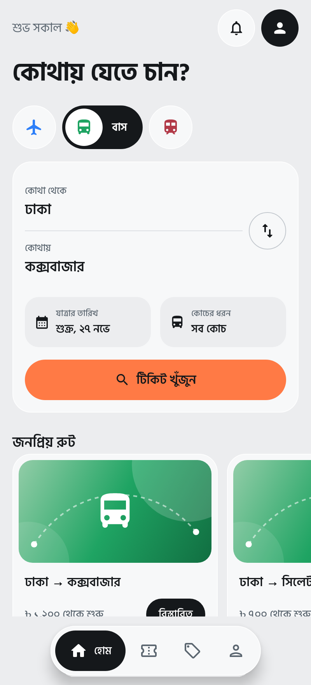
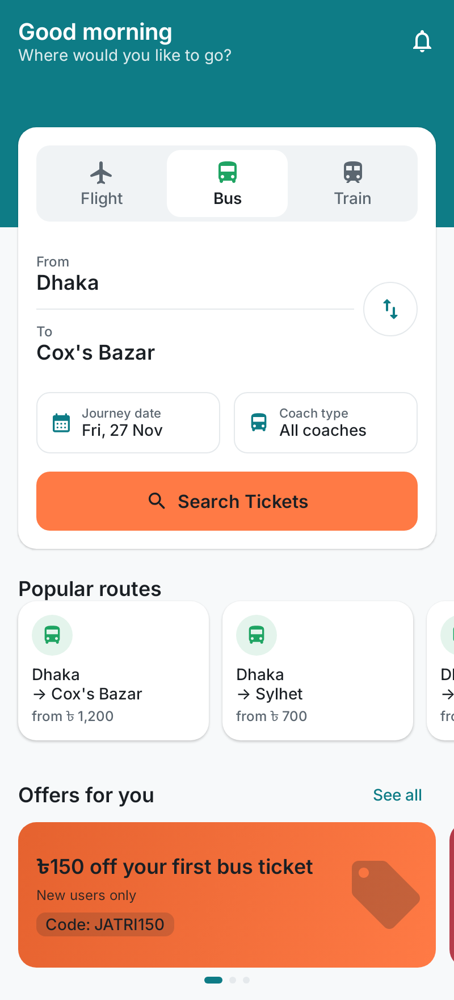
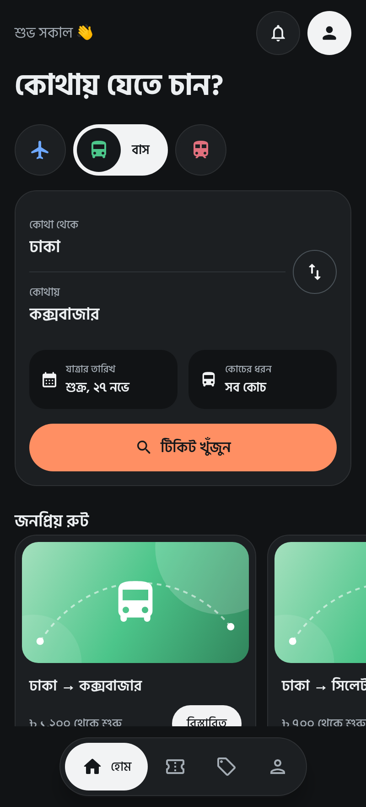
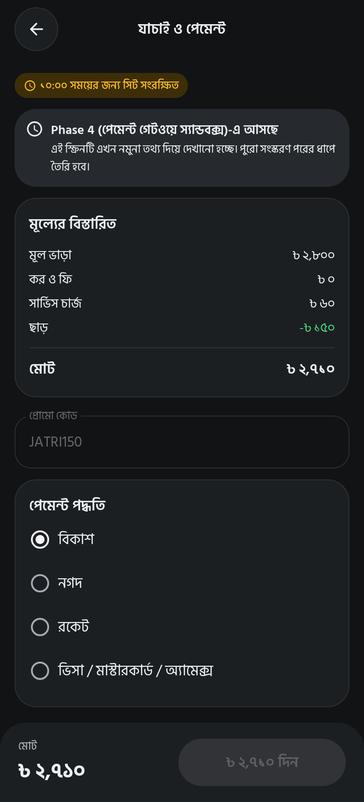

# Jatri (যাত্রী) — Air, Bus & Train Tickets

One Android app to search, compare, book and pay for **flight, bus and train tickets in Bangladesh**.
"Jatri" is a working name.

> **Status: Phase 2 (Auth) is done.** Phase 1 (foundation and the v2 "soft neutral" style) and
> Phase 2 (phone OTP login, tokens, profile, FastAPI backend) are built. The project structure, design system, navigation for all
> screens, Bangla/English and light/dark themes are in place. Search results, seat maps and payments
> show **sample data** until their phases are built (see [What is mocked](#what-is-mocked)).

| Bangla · light | English · light | Bangla · dark |
|---|---|---|
|  |  |  |
|  |  |  |

All 42 screenshots are in [`docs/screenshots/phase1`](docs/screenshots/phase1). They are rendered on the
JVM by Roborazzi, not on a phone.

## Repository layout

```
Jatri-App/
├── android/                 # Kotlin + Jetpack Compose app
│   ├── app/                 # MainActivity, splash, NavHost, bottom navigation, launcher icon
│   ├── build-logic/         # Gradle convention plugins (jatri.android.library, .feature, .hilt …)
│   ├── core/
│   │   ├── model/           # Pure-Kotlin domain types (Location, SearchQuery, Money in paisa …)
│   │   ├── common/          # BDT/Bangla-digit/date formatters, dispatchers, network monitor
│   │   ├── designsystem/    # Theme (colours, type, shapes, spacing), fonts, generic components
│   │   ├── ui/              # Travel UI: mode tabs, search card, pickers, result cards, seat map
│   │   ├── network/         # Retrofit/OkHttp/Kotlinx Serialization setup, API envelope
│   │   ├── database/        # Room (recent searches; tickets & travellers later)
│   │   ├── datastore/       # Settings: language, theme, onboarding
│   │   └── data/            # Repositories + seed locations + clearly-marked mock content
│   └── feature/             # auth, home, flight, bus, train, booking, payment,
│                            # trips, offers, account, notifications
├── backend/                 # FastAPI + PostgreSQL: auth, profile, locations (see backend/README.md)
├── design/                  # tokens.json, app icon SVG/PNG sources, font licences
├── docs/openapi.json        # API spec exported from the backend
└── docs/screenshots/
```

## Requirements

- **Android Studio** (a version that supports AGP 9.5) or the command line with **JDK 17+**
- Android SDK **platform 37.1** and **build-tools 37** (Android Studio installs them when you sync)
- Min SDK 24 (Android 7.0), target SDK 37

Toolchain: Gradle 9.9 · AGP 9.5 · Kotlin 2.4 · Compose BOM 2026.11 · Hilt 2.60 · Room 2.8 · Navigation 2.10.

## Run it

Open the `android/` folder in Android Studio and press **Run**, or:

```bash
cd android
./gradlew :app:assembleDebug          # debug APK → app/build/outputs/apk/debug/
./gradlew testDebugUnitTest           # unit tests + screenshot tests
./gradlew :app:recordRoborazziDebug   # re-render screenshots → app/build/outputs/roborazzi/
./gradlew :app:lintDebug              # lint for all modules (missing translations are errors)
./gradlew :app:assembleRelease        # R8-minified release APK (about 3.6 MB, unsigned)
```

The first launch shows onboarding (choose Bangla or English), then Home. Walk through it: pick
cities, then Search, a result, a seat or class, passenger details, Review & pay, and the success
screen. Every step in that flow can be reached.

## Phase 2 — login & accounts

- **Backend** (`backend/`): FastAPI, async SQLAlchemy, PostgreSQL, Alembic migrations, seed
  locations, Docker. It has 17 tests and passes on both SQLite and PostgreSQL. See [backend/README.md](backend/README.md).
- **Login**: phone number → 6-digit OTP → name (new users only). Errors come from the server in
  Bangla and English. The SMS Retriever API fills the code in automatically, with no SMS permission.
- **Tokens**: a 15-minute access token and a 30-day refresh token. Both are stored in one blob encrypted
  with AES-256-GCM, using an Android Keystore key that can't be exported. On a 401 the app refreshes
  once and retries. If the refresh fails, the user is logged out.
- **Account**: profile card, edit name and email, log out (works offline), and delete account
  (Google Play requirement).
- **Booking needs login**: guests can search freely. "Continue" to the passenger form asks
  them to log in, then carries on.
- **Locations** come from `GET /locations`, with the bundled list as the offline fallback.

### Mock backend vs real backend

The APK works on any phone **without a server**: by default it uses a built-in mock backend that
follows the same rules (the OTP is always **123456**). To use the real API:

```bash
cd android
./gradlew :app:assembleDebug -Pjatri.useMockApi=false -Pjatri.apiBaseUrl=http://10.0.2.2:8000/api/v1/
```

`10.0.2.2` is your computer as seen from the Android emulator. Debug builds allow plain HTTP only
to `10.0.2.2` and `localhost`. Release builds are HTTPS-only.

## Phase 1 — what's built

- **Design system**: Material 3 light/dark colour schemes (dynamic colour off), bundled fonts
  (Hind Siliguri, Inter, Plus Jakarta Sans — all OFL), a 4 dp spacing grid, pill buttons and chips,
  and 24 dp cards. See [Visual style](#visual-style-v2).
- **Components**: CTA/primary/outlined/small buttons, `PillChip`, `CircleIconButton`, card, status & tag chips, empty/error/loading states,
  shimmer skeletons, offline banner, `TicketShape` + `TicketCard`, `PriceSummaryBar`,
  `PassengerCounter`, top bar, text field, bottom sheet, `SearchCard`, `TravelModeTabs`,
  `CityPickerSheet`, `DatePickerSheet`, `PassengerClassSheet`, flight/bus/train `ResultCard`s, and `SeatMap`.
- **Navigation**: type-safe Navigation Compose routes for all 25 screens. A floating pill bottom bar
  has Home · My Trips · Offers · Account.
- **Language**: everything is in `strings.xml` (`values` = English, `values-bn` = Bangla). Bangla is
  the default. Language can be switched in onboarding and in Account, using the per-app locale API.
  Bangla digits appear in prices, dates and counts.
- **Money** is stored as whole paisa (`Money(paisa: Long)`) and formatted with lakh grouping:
  `৳ 1,25,000` / `৳ ১,২৫,০০০`.
- **App icon**: an adaptive icon plus a monochrome version (Android 13+ themed icons), and the Android 12+ splash screen.
- **Local data**: recent searches saved in Room, settings in DataStore.
- **Tests**: formatters, phone validation, seed data, seat-selection rules (max 4, booked seats
  blocked), and 36 screenshot tests (Bangla light, English light, Bangla dark).

## What is mocked

| Area | Phase 1 behaviour | Becomes real in |
|---|---|---|
| SMS gateway | Backend prints the OTP to its log; the APK's mock backend uses 123456 | Before release |
| Bus results, seat map | `MockContent` with placeholder operators ("Sample Paribahan") | Phase 3 |
| Passenger form | Layout preview with disabled fields | Phase 3 |
| Review & pay, payment result | Sample price breakdown, working 10:00 hold timer, no real payment | Phase 4 |
| Flight results, fare rules | `MockContent` with placeholder airlines ("Sample Air") | Phase 5 |
| Train results | `MockContent` ("Sample Express") | Phase 6 |
| My Trips, ticket detail | One sample ticket, clearly labelled | Phase 7 |
| Offers, popular routes | Sample promo codes | Phase 8 |
| Hotline number | Placeholder `+8809600000000` in `HelpScreen` | Before release |

Every placeholder screen shows a "Coming in Phase N" banner, so sample data can't be mistaken for
real data.

## Visual style (v2)

Soft neutral look: a grey canvas, lighter cards with a hairline light edge, very round shapes and
big bold left-aligned headlines.

- **Black "pills" mark what is selected**: mode, date, sort option, tab, class, language. In dark
  mode the pills are white.
- **Orange is only for the main money/search actions** ("Search Tickets", "Pay", "Continue"), so they
  always stand out. Teal stays as the brand colour (icon, splash).
- **Gradient artwork instead of photos**: each mode's colour with a dashed route arc and a big
  white icon (`ModeIllustration`). Real operator photos can replace it later.
- **Floating pill bottom navigation**: the active tab shows icon + label, the others show icons
  only (their labels are still read by screen readers).
- **Result cards**: times on both sides, a line with the mode icon in the middle, the operator and
  price below. Results have a strip of date pills (±2 days) that reloads the list.
- **Fonts**: Plus Jakarta Sans for English headlines, Inter for English text, Hind Siliguri (bold
  for headlines) for Bangla.

## Design decisions worth knowing

- **Dark text on orange buttons.** White on `#FF7A45` is only 2.6:1 contrast and fails WCAG AA.
  Ink on orange is 6.5:1. Black pills with white text are about 18:1.
- **Warning and success text** use darker shades on light cards for the same reason.
- **Seat codes (A1, B2) stay in Latin letters and ASCII digits** in both languages, because they are
  printed on the bus that way.
- **System bar icons follow the app theme** (dark icons on the light canvas, light icons in dark mode).
- **No backups**: `allowBackup=false` and data-extraction rules exclude everything, so tokens and
  tickets never leave the device.

---

## সংক্ষেপে (বাংলা)

**যাত্রী** একটি অ্যান্ড্রয়েড অ্যাপ। এতে বাংলাদেশের ফ্লাইট, বাস ও ট্রেনের টিকিট এক জায়গায় খোঁজা, তুলনা করা, বুক করা ও পেমেন্ট করা যাবে।

**এখনকার অবস্থা: Phase 1 (ভিত্তি) সম্পন্ন, নতুন "নরম ধূসর" ডিজাইনসহ।** বাছাই করা জিনিস কালো pill-এ, মূল বাটন কমলা, ছবির জায়গায় gradient ইলাস্ট্রেশন, আর নিচে ভেসে থাকা pill navigation।
- প্রজেক্টের কাঠামো আর মডিউলগুলো তৈরি হয়েছে।
- ডিজাইন সিস্টেম তৈরি: কালার, ফন্ট (হিন্দ শিলিগুড়ি ও ইন্টার) আর কম্পোনেন্ট।
- সব স্ক্রিনে navigation দিয়ে যাওয়া যায়।
- বাংলা ও ইংরেজি দুই ভাষাই আছে। বাংলা ডিফল্ট, আর বাংলায় সংখ্যাও বাংলায় দেখায়।
- লাইট ও ডার্ক থিম আছে।
- অ্যাপ আইকন আর স্প্ল্যাশ স্ক্রিন তৈরি।

সার্চের ফলাফল, সিট ম্যাপ, পেমেন্ট আর আমার যাত্রা এখন **নমুনা তথ্য** দেখায়। প্রতিটি স্ক্রিনে "Phase N-এ আসছে" লেখা থাকে।

**চালানোর নিয়ম:** Android Studio-তে `android/` ফোল্ডার খুলে Run চাপুন। অথবা কমান্ড লাইনে `cd android && ./gradlew :app:assembleDebug` চালান।

**Phase 2 সম্পন্ন:**
- ফোন নম্বর ও OTP দিয়ে লগইন।
- এনক্রিপ্ট করা টোকেন, মেয়াদ শেষ হলে নিজে থেকে রিফ্রেশ।
- প্রোফাইল সম্পাদনা, লগআউট আর অ্যাকাউন্ট মুছে ফেলার সুবিধা।
- FastAPI + PostgreSQL ব্যাকএন্ড।

সার্ভার ছাড়াও APK ফোনে চলে। ডেমো মোডে OTP সবসময় **123456**।

**পরের ধাপ:** Phase 3। এতে বাস মডিউল আসবে: সার্চ, সিট ম্যাপ, যাত্রীর ফর্ম আর বুকিং হোল্ড।
